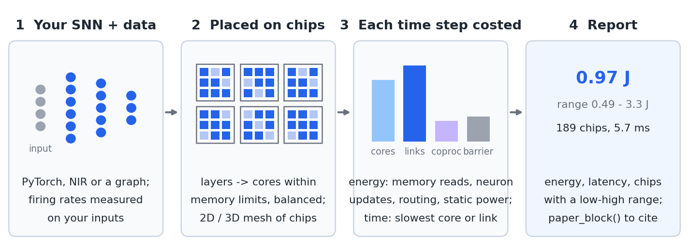
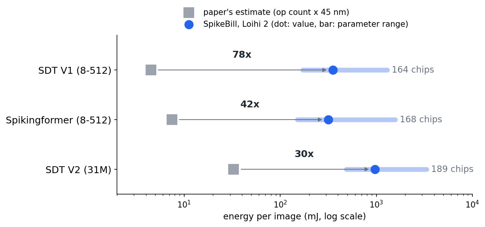
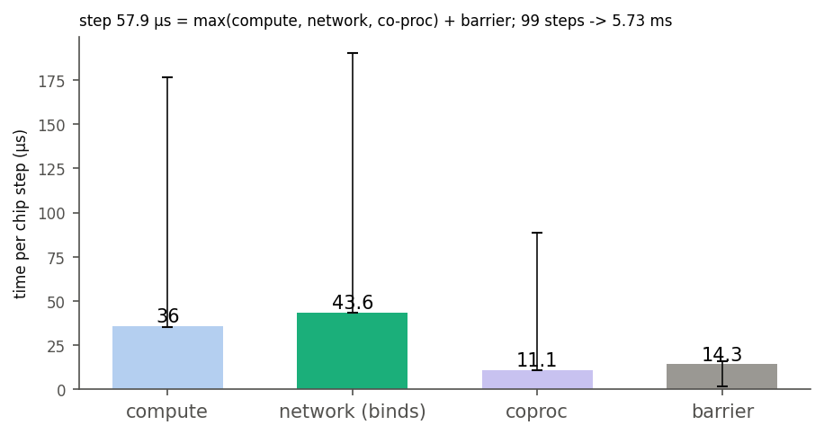
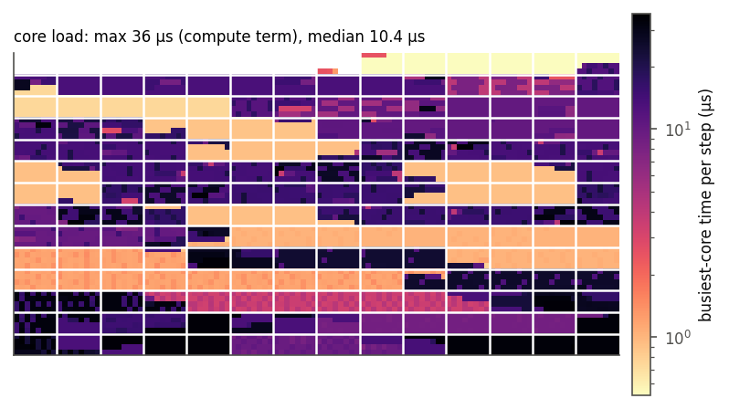
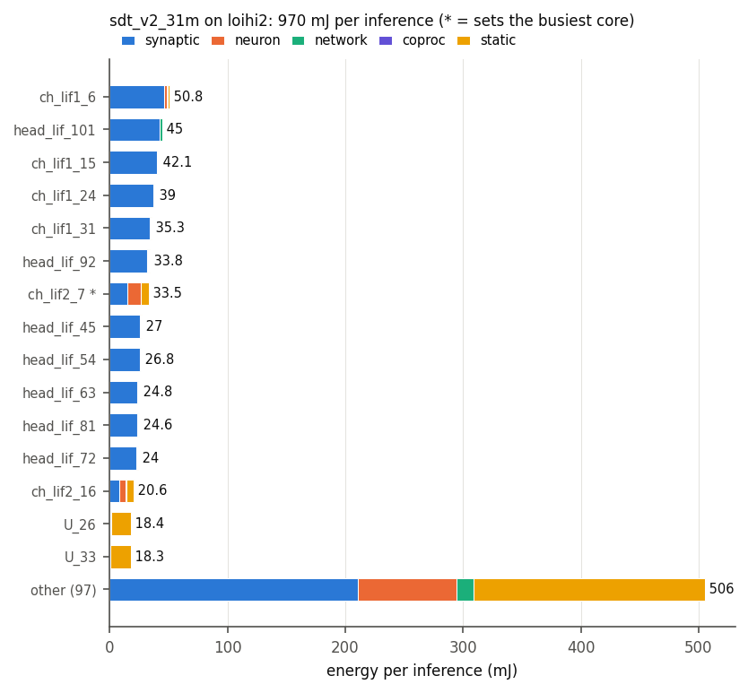

# SpikeBill

SpikeBill estimates what a spiking neural network (SNN) costs to run on a neuromorphic chip system: the energy and
latency of one inference and the number of chips it needs. It places the model on the cores of one or more chips and
costs each time step as the chips would run it, so the estimate includes the costs that an operation count leaves
out: synaptic-memory reads, spike traffic between cores and chips, the wait for the slowest core in every step, and
the static power of every chip in use. Each chip parameter carries a low and a high value next to its nominal value,
and every estimate is reported with the range they span.



*SpikeBill in four steps. (1) It reads your network and measures the firing rate of every layer on your inputs.
(2) It places the layers on the cores of as many chips as the network needs. (3) It costs one time step: the energy
of every memory read, neuron update, spike message and powered chip, and the time until the slowest core or link
finishes. (4) It reports energy and latency per inference, the chip count, and their range over the chip
parameters. The numbers in panel 4 are those of Spike-driven Transformer V2 on Loihi 2.*

The gap to the usual operation-count estimate is large for published models:



*The three spiking transformers above report their energy as an operation count times 45 nm energies per operation
(grey). On a Loihi-2-class system of 164-189 chips, with the firing rates the papers report, SpikeBill estimates
30-78 times more energy per image (blue dot: nominal parameters; bar: low to high parameters). These are model
estimates, not measurements on silicon; [Validation and limits](#validation-and-limits) says how far they are
checked.*

## Install

SpikeBill needs Python 3.10 or newer.

```bash
git clone https://github.com/snuhcs/spikebill && cd spikebill
pip install -e .              # core: numpy, scipy, pyyaml, networkx
pip install -e .[snntorch]    # adds PyTorch, snnTorch and NIR, for tracing PyTorch models
pip install -e .[all]         # every optional package, including the test and plotting tools
```

## Quickstart

### From a PyTorch model

The example below defines a small convolutional SNN in snnTorch, runs it on random input spikes, and estimates its
cost on Loihi 2. To estimate your own network, replace `Net()` with your trained model and `inputs` with a batch of
your data; the input shape is (time steps, batch, ...), and the model is called once per time step.

```python
import torch, torch.nn as nn
import snntorch as snn
from spikebill import Simulator

class Net(nn.Module):
    def __init__(self):
        super().__init__()
        self.conv, self.lif1 = nn.Conv2d(1, 8, 5), snn.Leaky(beta=0.9, init_hidden=True)
        self.fc, self.lif2 = nn.Linear(8 * 24 * 24, 10), snn.Leaky(beta=0.9, init_hidden=True)

    def forward(self, x):
        return self.lif2(self.fc(self.lif1(self.conv(x)).flatten(1)))

inputs = (torch.rand(8, 16, 1, 28, 28) < 0.2).float()    # 8 time steps, batch of 16, 1 x 28 x 28
sim = Simulator.from_torch(Net(), inputs, chip="loihi2")
report = sim.run(ranges=True)
print(report.summary())                 # energy and latency per inference, with the parameter range
print(report.paper_block("markdown"))   # the numbers and every setting that changes them, to paste into a paper
```

`Simulator.from_torch` runs the model on the inputs and records the firing rate of every neuron layer, so the
estimate uses the activity of your network rather than an assumed rate. `report.view("step.html")` writes an
interactive view of one time step.

### From a NIR file

[NIR](https://neuroir.org) is a common exchange format for SNNs; snnTorch, Norse, Sinabs, Rockpool, Lava-dl and other
frameworks export to it. A NIR file stores the network but not its activity, so SpikeBill first simulates the network
on input spikes to get the firing rates, then estimates the cost with them. The example writes a small two-layer
network as a NIR file so that it runs as is; for your own network, skip that part and use the file your framework
exports.

```python
import numpy as np
import nir
from spikebill import Simulator, activity

rng = np.random.default_rng(0)
lif = lambda n: nir.LIF(tau=np.full(n, 10.0), r=np.ones(n), v_leak=np.zeros(n), v_threshold=np.ones(n))
graph = nir.NIRGraph.from_list(nir.Affine(weight=rng.random((128, 784)) * 0.02, bias=np.zeros(128)), lif(128),
                               nir.Affine(weight=rng.random((10, 128)) * 0.2, bias=np.zeros(10)), lif(10))
nir.write("model.nir", graph)                               # replace with your exported file

spikes = (rng.random((25, 784)) < 0.1).astype(float)       # input spikes: (time steps, input neurons)
act = activity.from_nir("model.nir", spikes)                # firing rate of every layer: {layer: spikes per step}
report = Simulator("model.nir", chip="loihi2").run(rates=act.rates, steps=act.steps, ranges=True)
print(report.summary())
```

`activity.from_nir` simulates the neurons as the chip updates them (`semantics="loihi"`); `semantics="framework"`
follows the training framework instead, and the two can differ in deep networks. If you already know the firing
rates, skip the simulation: `spikebill model.nir --rate 0.05` uses one rate for every layer, and `--rates rates.json`
one rate per layer.

### Without a model

The command line estimates a shipped model:
`spikebill zoo:sdt_v1_8_512 --range --by-pop 10` prints the cost of Spike-driven Transformer V1 and its ten most
expensive layers. [`examples/`](examples/README.md) has more complete scripts.

## Supported models and inputs

SpikeBill reads a model in one of five forms. The form decides where the firing rates come from.

| model form | how to load it | firing rates |
|---|---|---|
| PyTorch module | `Simulator.from_torch(model, inputs)` | measured on `inputs` while tracing |
| NIR file (`.nir`, `.h5`) | `Simulator("model.nir")`, `spikebill model.nir` | given by you, or simulated with `spikebill.activity.from_nir` |
| graph built in code | `spikebill.NetBuilder` | given per layer when building |
| saved graph (`.json`) | `Simulator("graph.json")`, `Graph.save` / `graph.load` | stored in the file |
| model zoo | `Simulator("zoo:<name>")`, `spikebill --list-zoo` | the rates the original paper reports |

**PyTorch.** The tracer recognises snnTorch neurons (`Leaky`, `Synaptic`, `Lapicque`, `Alpha` and other
`SpikingNeuron` classes), every SpikingJelly neuron in single-step or multi-step mode (`multi_step=True`), and your
own neuron classes passed as `neuron_types=(MyLIF,)`. Between neurons it maps `Conv1d`, `Conv2d` and `Linear` layers
to synapses, max and average pooling of spikes to pooling neurons, residual additions to accumulator neurons, and
treats batch norm, dropout, flatten and reshapes as pass-through. Products of two spike tensors, as in spiking
attention, are measured and either left out (default), built from AND-gate neurons (`attention="andgate"`) or run on
a co-processor (`attention="coproc"`). Operations that do not act on spikes (softmax, layer norm, GELU and similar)
are not costed; the tracer lists them with their element counts in `info["unmapped_ops"]` and warns. Inputs that are
not binary spikes are sent as one message per element per step.

**NIR.** Neuron nodes `IF`, `LIF`, `CubaLIF`, `LI`, `CubaLI` and `Threshold`; weight nodes `Affine`, `Linear`,
`Conv1d`, `Conv2d`, `SumPool2d` and `AvgPool2d`; and `Flatten`, `Scale` and `Delay` between them. Synapse counts are
exact (non-zero weights). NIR does not store weight precision; `weight_bits` sets it (default 8).

**Activity files.** Firing rates can also come from a JSON file, `{"layer name": spikes per neuron per step}`
(`--rates`, or `--rate 0.05` for all layers). A recorded spike trace, one array of spike counts per layer and time
step in `.npz` or `.json`, gives the power of every step (`--trace`, `Simulator.power_trace`).

**Chips.** Shipped parameter files: `loihi1` (calibrated against the event-level simulator SANA-FE), `loihi2`, and
`loihi2_3d` (four Loihi 2 dies stacked in 3D). A new chip is a YAML file that gives every parameter a value, a range
and a source ([`docs/chips.md`](docs/chips.md)); `--chip my_chip.yaml` uses it.

The cost model describes chips of the Loihi type: cores in a 2D or 3D mesh, synaptic weights stored at the
destination core, and a global time step. It does not estimate GPUs or other non-spiking accelerators, and it does
not include chip I/O or a host processor.

## How a step is costed

In every time step, each spike reads the weights of its synapses at the destination cores, every neuron updates its
state, and spike messages travel over the mesh of cores and the links between chips. The step ends when the slowest
core, the busiest link or the attention co-processor finishes, followed by a barrier that synchronises all chips.
Energy per step is the sum of synaptic, neuron, network and co-processor energy plus the static power of every
powered chip over the step time. An inference takes as many steps as the network has time steps, plus the pipeline
depth when layers run in a pipeline. The model is compiled to sparse matrices, so a model of 3.35 x 10^8 neurons on
1406 chips takes about three minutes on one machine. [`docs/cost_model.md`](docs/cost_model.md) gives the equations
and every assumption.



*One time step of Spike-driven Transformer V2 (31M) on 189 Loihi 2 chips takes 57.9 us at nominal parameters. The
network sets it (43.6 us); the bars show each term at nominal parameters and the whiskers its low-high range.*

## Seeing where the cost goes

A single number does not show which layers or which parts of the chip system cost the most. Two kinds of view do.
`plots.save_all(report, "figs/")` writes four figures as PDF and PNG (energy by layer, step-time terms, placement
of the layers, load of every core), and `report.view("step.html")` writes an interactive page of one time step that
shows the load of every core and link.

```python
from spikebill import plots
plots.save_all(report, "figs/")      # report from Simulator.run, as in the Quickstart
report.view("step.html")
```

The two figures below come from Spike-driven Transformer V2 on 189 Loihi 2 chips.



*Load of every core. Each pixel is one core, white lines separate the chips, and the colour is the time the core
needs per step (log scale). The slowest core sets the compute term of the step (36 us); half of the cores need less
than 10.4 us, so most cores wait for a few busy ones.*



*Energy per inference of the 15 most expensive layers, split into synaptic, neuron, network, co-processor and static
energy; the star marks the layer with the busiest core. Synaptic-memory reads dominate the expensive layers, while
static power is spread over all chips (bottom bar, the other 97 layers).*

## Reporting energy in a paper

A cost estimate is reproducible only with the chip, the parameter version, the mapping and the source of the firing
rates. `report.paper_block()` prints all four next to the energy and latency, and
[`docs/reporting.md`](docs/reporting.md) gives a short checklist for papers. The zoo's reference estimates of
published spiking transformers and SpikeGPT give a common point of comparison.

## Validation and limits

The estimates are checked against simulators; no Loihi 2 or multi-chip measurement has been reproduced yet.

- Against the event-level simulator SANA-FE on held-out Loihi 1 workloads, energy is within 0.2% and latency within
  6.2%.
- Against a packet-level network simulation, the network term of SpikeGPT on 13 chips is within 8% (unicast and
  tree multicast, three random seeds), and chip-broadcast steps on 1-57 chips are within 17%. With finite router
  queues of 16 flits per link, 78% of steps are within 20%; with 4 flits, only 57% are, and the model is optimistic.
- Loihi 2 energies per event are not public. SpikeBill uses Loihi 1 values scaled by one factor fitted to published
  Loihi 2 measurements (0.33-1.0). A second published Loihi 2 workload draws 11-22 times more power than predicted;
  the likely cause, I/O and embedded processors that the model leaves out, is untested.
- Attention products run either as neurons or on a co-processor whose parameters are assumed; the report states
  which.

`spikebill-validate` reruns these checks against their pre-registered pass criteria.
`python examples/reproduce_paper.py` recomputes 112 numbers of the white paper and compares each with the printed
value (about 3 minutes).

## Documentation

- [`docs/api.md`](docs/api.md): the Python API and the command line.
- [`docs/cost_model.md`](docs/cost_model.md): the cost model, its equations and its limits.
- [`docs/chips.md`](docs/chips.md): chip parameters, their sources, and how to add a chip.
- [`docs/reporting.md`](docs/reporting.md): what to report with an estimate.

## Citing

Until the white paper appears, please cite the software. GitHub shows the same entry under "Cite this repository"
(from [`CITATION.cff`](CITATION.cff)).

```bibtex
@software{spikebill2026,
  author  = {Oh, Hyunseok and Lee, Youngki},
  title   = {{SpikeBill}: energy, latency and chip count of spiking neural networks on neuromorphic chip systems},
  year    = {2026},
  version = {0.1.0},
  url     = {https://github.com/snuhcs/spikebill},
  license = {Apache-2.0}
}
```

When you report an estimate, also give the chip file and its version, which `report.paper_block()` prints.

## License

Apache License 2.0 ([`LICENSE`](LICENSE), [`NOTICE`](NOTICE)). Intel and Loihi are trademarks of Intel Corporation;
SpikeBill is not affiliated with or endorsed by Intel.
